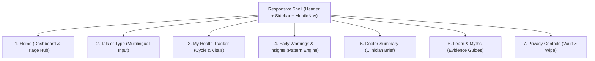
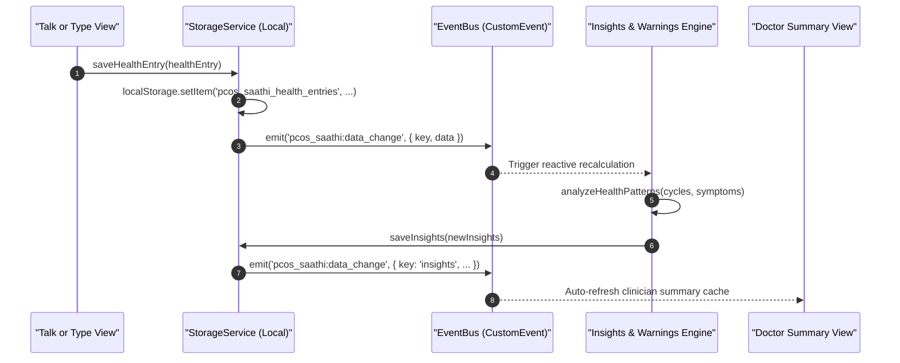

# PCOS Saathi — Project Architecture & Technical Specification

> **Status:** Final Approved Architecture  
> **Role:** Lead Architect  
> **Version:** 3.0.0 (Production Hackathon Baseline)  
> **Target Audience:** All 9 Development Team Members  
> **Core Constraint:** Zero remote database (No MongoDB, PostgreSQL, Firebase). 100% offline-first local persistence via `localStorage`/`IndexedDB`.

---

## 1. Executive Summary & Vision

**PCOS Saathi** is an empathetic, multilingual, privacy-first companion designed to help women navigate Polycystic Ovary Syndrome (PCOS) and reproductive health.

The system addresses a critical healthcare gap: women often experience vague, distressing symptoms (irregular periods, hirsutism, cystic acne, severe cramps, rapid weight shifts) across months without knowing how to articulate them to clinicians.

### Core Architectural Invariants
1. **Privacy-by-Architecture**: Health entries, cycle dates, and personal notes **never touch an external database or server**. All data resides exclusively on the user’s device hardware.
2. **Deterministic Safety Rules**: Symptom extraction and red-flag identification run on deterministic, explainable rule sets. The system **never prescribes medications, never suggests dosages, and never gives a definitive medical diagnosis**.
3. **Graceful Fallback Mode**: If any optional network feature (e.g. cloud Whisper or stateless FastAPI synthesis) fails or is disabled by the user, the application seamlessly falls back to 100% client-side execution with zero UI degradation.
4. **Shared Data Contracts**: All 9 developers work against immutable, shared data schemas and a unified reactive event bus.

---

## 2. Review of Existing Codebase & Reuse Decisions

Following a comprehensive audit of the repository, the architectural reuse decisions are:

| File / Component | Status | Architectural Decision & Action |
| :--- | :--- | :--- |
| `src/components/layout/*` (`Header`, `Sidebar`, `MobileNav`, `PageHeader`, `GlobalError`) | **REUSE (Core Shell)** | Forms the responsive shell across mobile (bottom nav) and desktop (sidebar). All developers must mount their views inside this shell. |
| `src/components/common/*` (`Button`, `Card`, `Badge`, `DisclaimerBanner`, `UrgentWarning`, etc.) | **REUSE (Design System)** | Standardized atom components. Developers must NOT create ad-hoc buttons or modal cards; use this design system. |
| `src/components/TalkOrType.jsx` & `src/services/speechService.js` | **REUSE & ENHANCE** | Multilingual speech-to-text (English, Hindi, Kannada, Tamil, Malayalam) and live audio status state machine. Integrated directly into `TalkView`. |
| `src/services/symptomExtractor.js` | **REUSE** | High-performance deterministic regex keyword extractor mapping colloquial vernacular terms to normalized symptom categories. |
| `src/services/patternDetectionService.js` | **REUSE & CORE** | 540 lines of battle-tested, deterministic pattern detection rules and red-flag logic. Powers the **Early Warnings and Insights** view. |
| `src/components/CycleTracker.jsx` | **REUSE & UPGRADE** | Upgraded to persist to `pcos_saathi_cycle_entries` using the standardized `CycleEntry` schema while maintaining legacy fallback. |
| `src/models/healthEntry.js` | **REUSE (Bridge)** | Retained as backward-compatibility bridge forwarding to `src/models/pcosSaathiSchemas.js` and `src/services/storageService.js`. |
| `src/components/PrivacyControls.jsx` | **REUSE & EXPAND** | Upgraded to purge all `pcos_saathi_*` keys, manage `pcos_saathi_ai_consent`, and provide single-click JSON backup export/import. |
| `src/components/EducationLibrary.jsx` & `src/views/LearnView.jsx` | **REUSE & MERGE** | Consolidated into the **Learn and Myths** product area. |

---

## 3. Product Areas & Route Mapping

The application is decomposed into **7 distinct product areas**, each owned by designated team members:



| Area # | Product Area | Route / View State | Primary Responsibility | Assigned LocalStorage Key |
| :---: | :--- | :--- | :--- | :--- |
| **1** | **Home** | `/` | Daily overview, quick triage, latest active red flags, cycle countdown card, emergency help | Reads all keys (read-only aggregate) |
| **2** | **Talk or Type** | `/talk` | Speech/text input in 5 languages, symptom confirmation cards, entry creation | `pcos_saathi_health_entries` |
| **3** | **My Health Tracker** | `/tracker` | Period start/end logging, flow levels, pain rating (0-10), symptom correlation | `pcos_saathi_cycle_entries` |
| **4** | **Early Warnings & Insights** | `/insights` | Deterministic analysis, irregular cycle detection, symptom clustering, red-flag banners | `pcos_saathi_insights` |
| **5** | **Doctor Summary** | `/summary` | Aggregated timeline, clinician question checklists, 1-page print/PDF sheet, copy brief | `pcos_saathi_doctor_summary` |
| **6** | **Learn & Myths** | `/learn` | Myth-vs-fact interactive cards, dietary guidance, lifestyle factors, reassurance | Reads static dictionary & articles |
| **7** | **Privacy Controls** | `/privacy` | Device-only vault status, AI opt-in toggle, export data (JSON), emergency wipe | `pcos_saathi_preferences`, `pcos_saathi_ai_consent` |

---

## 4. Final Folder Structure

All code is structured to ensure zero file collision among the 9 developers working concurrently:

```text
pcos-saathi/
├── docs/
│   ├── architecture.md           <-- This document (System Blueprint)
│   ├── api_contract.md           <-- FastAPI, EventBus & Schema Specification
│   └── integration_checklist.md  <-- 9-Developer Sprint & Integration Board
├── public/
│   ├── favicon.svg
│   └── icons.svg
├── src/
│   ├── assets/                   <-- Static imagery, illustrations
│   ├── components/
│   │   ├── common/               <-- Reusable design system atoms
│   │   │   ├── Badge.jsx
│   │   │   ├── Button.jsx
│   │   │   ├── Card.jsx
│   │   │   ├── DisclaimerBanner.jsx
│   │   │   ├── EmptyState.jsx
│   │   │   ├── LanguageSelector.jsx
│   │   │   ├── LoadingState.jsx
│   │   │   └── UrgentWarning.jsx
│   │   ├── layout/               <-- Shell components
│   │   │   ├── GlobalError.jsx
│   │   │   ├── Header.jsx
│   │   │   ├── MobileNav.jsx
│   │   │   ├── PageHeader.jsx
│   │   │   └── Sidebar.jsx
│   │   ├── home/                 <-- Area 1 components
│   │   ├── talk/                 <-- Area 2 components (TalkOrType, SymptomCards, StateBar)
│   │   ├── tracker/              <-- Area 3 components (CycleCalendar, FlowPicker)
│   │   ├── insights/             <-- Area 4 components (WarningCards, PatternList)
│   │   ├── summary/              <-- Area 5 components (ClinicianSheet, QuestionChecklist)
│   │   ├── learn/                <-- Area 6 components (MythCards, ArticleViewer)
│   │   └── privacy/              <-- Area 7 components (VaultWipe, ConsentToggle)
│   ├── data/
│   │   ├── languages.js          <-- Multilingual translations & example prompts
│   │   └── pcosMyths.js          <-- Myth vs fact structured dictionary
│   ├── models/
│   │   ├── pcosSaathiSchemas.js  <-- Canonical 6 shared object factories & keys
│   │   └── healthEntry.js        <-- Backward compatibility bridge
│   ├── services/
│   │   ├── storageService.js     <-- Unified client-side storage engine
│   │   ├── eventBus.js           <-- Reactive inter-component EventBus
│   │   ├── speechService.js      <-- Web Speech API service with fallback
│   │   ├── symptomExtractor.js   <-- Deterministic vernacular symptom parser
│   │   ├── patternDetectionService.js <-- Deterministic insight & red flag rules
│   │   └── apiService.js         <-- Optional stateless FastAPI client with offline fallback
│   ├── views/
│   │   ├── HomeView.jsx
│   │   ├── TalkView.jsx
│   │   ├── TrackerView.jsx
│   │   ├── InsightsView.jsx
│   │   ├── SummaryView.jsx
│   │   ├── LearnView.jsx
│   │   └── PrivacyView.jsx
│   ├── App.jsx                   <-- Top-level routing & layout shell
│   ├── index.css                 <-- Tailwind directives & design tokens
│   └── main.jsx                  <-- React application entry point
├── backend/ (OPTIONAL)           <-- Stateless FastAPI microservice (ZERO DATABASE)
│   ├── app/
│   │   ├── main.py
│   │   ├── routers/
│   │   │   ├── extraction.py     <-- Stateless LLM/NLP symptom normalization
│   │   │   └── summary.py        <-- Ephemeral clinician report synthesis
│   │   └── schemas/              <-- Pydantic schema counterparts
│   └── requirements.txt
├── demo.html                     <-- Zero-install browser demo runner
├── package.json
├── tailwind.config.js
└── vite.config.js
```

---

## 5. Shared Data Models & Storage Architecture

### 5.1 Strictly Enforced LocalStorage Keys

No developer may use ad-hoc localStorage keys. All persistence must go through `StorageService` using these exact 6 keys:

| LocalStorage Key | Data Structure | Purpose |
| :--- | :--- | :--- |
| `pcos_saathi_health_entries` | `HealthEntry[]` | Structured logs of symptoms, voice transcripts, and user notes |
| `pcos_saathi_cycle_entries` | `CycleEntry[]` | Menstrual period logs, flow levels, and cycle dates |
| `pcos_saathi_insights` | `Insight[]` | Generated patterns (irregularities, clusters, severities) |
| `pcos_saathi_doctor_summary` | `DoctorSummary` | Most recently compiled 1-page clinician brief |
| `pcos_saathi_preferences` | `Preferences` | Language (`en`, `hi`, `kn`, `ta`, `ml`), theme, reminders |
| `pcos_saathi_ai_consent` | `AiConsent` | Explicit opt-in flags; `telemetryAllowed` is **always false** |

### 5.2 Canonical Object Definitions (JSDoc & TypeScript Contract)

All 6 models are defined and factory-instantiated in [`src/models/pcosSaathiSchemas.js`](file:///c:/Users/spurv/OneDrive/Documents/choas/src/models/pcosSaathiSchemas.js):

#### 1. `HealthEntry`
```typescript
interface HealthEntry {
  id: string;               // e.g. "he-1729000000-abc"
  timestamp: string;        // ISO 8601
  version: "1.0.0";
  language: "en" | "hi" | "kn" | "ta" | "ml";
  inputMode: "speech" | "text" | "manual";
  rawTranscript: string;
  symptoms: Array<{
    id: string;
    name: string;
    duration: string;       // e.g. "3 months"
    frequency: string;      // e.g. "Daily"
    severity: "Mild" | "Moderate" | "Severe" | "Unspecified";
    category: "Hormonal" | "Cycle" | "Pain" | "Metabolic" | "Mood" | "General";
    isCustom?: boolean;
  }>;
  notes: string;
  tags: string[];
  vitals?: {
    weightKg?: number | null;
    bpSystolic?: number | null;
    bpDiastolic?: number | null;
    sleepHours?: number | null;
    stressLevel?: number | null; // 1-5
  };
  safety?: SafetyResult;
  metadata: {
    source: string;
    appVersion: string;
    exportedAt: string;
  };
}
```

#### 2. `CycleEntry`
```typescript
interface CycleEntry {
  id: string;               // e.g. "cy-1729000000-xyz"
  startDate: string;        // "YYYY-MM-DD"
  endDate: string | null;   // "YYYY-MM-DD" or null if ongoing
  cycleLengthDays: number | null; // Calculated days from previous cycle start
  periodDurationDays: number | null;
  flowLevel: "spotting" | "light" | "medium" | "heavy";
  painScore: number;        // Integer 0 to 10
  associatedSymptoms: string[]; // e.g. ["Severe cramps", "Migraine"]
  notes: string;
  timestamp: string;        // ISO 8601
}
```

#### 3. `Insight`
```typescript
interface Insight {
  id: string;
  generatedAt: string;      // ISO 8601
  category: "cycle_regularity" | "symptom_progression" | "cluster_correlation" | "lifestyle";
  title: string;            // e.g. "Cycle Length Variability Detected"
  summary: string;          // 1-2 concise sentences
  details: string[];        // Supporting evidence bullet points
  evidenceEntries: string[];// IDs of triggering HealthEntries or CycleEntries
  confidence: "high" | "moderate" | "exploratory";
  suggestedAction: string;  // e.g. "Discuss cycle timeline with your gynecologist"
  disclaimer: string;       // Non-diagnostic disclaimer
}
```

#### 4. `DoctorSummary`
```typescript
interface DoctorSummary {
  id: string;
  generatedAt: string;
  patientProfile: {
    preferredLanguage: string;
    ageRange: string;
    primaryConcerns: string[];
  };
  timeframe: {
    fromDate: string;
    toDate: string;
    totalEntriesCount: number;
  };
  symptomFrequency: Record<string, number>; // e.g. { "Facial Hair": 5, "Pelvic Pain": 3 }
  cycleMetrics: {
    averageCycleDays: number | null;
    longestCycle: number | null;
    shortestCycle: number | null;
    irregularityScore: "regular" | "variable" | "irregular" | "unknown";
  };
  activeRedFlags: RedFlag[];
  keyInsights: Insight[];
  questionsForClinician: string[];
  printableText: string;
  disclaimer: string;
}
```

#### 5. `RedFlag`
```typescript
interface RedFlag {
  id: string;               // e.g. "rf-fever-pelvic-1729"
  ruleId: string;           // e.g. "fever_with_pelvic_pain"
  title: string;            // e.g. "Fever with Acute Pelvic Pain"
  description: string;      // Objective clinical explanation
  urgencyLevel: "emergency" | "urgent_clinical" | "routine_followup";
  actionPrompt: string;     // e.g. "Contact 108 or proceed to nearest hospital emergency"
  emergencyHelpline: string;// "108"
  detectedAt: string;       // ISO 8601
  triggerKeywords: string[];// e.g. ["fever", "severe pelvic pain"]
}
```

#### 6. `SafetyResult`
```typescript
interface SafetyResult {
  isSafe: boolean;
  hasRedFlags: boolean;
  redFlags: RedFlag[];
  blockedPrescriptions: string[]; // Medication/dosage terms intercepted and stripped
  sanitizedText: string;
  disclaimer: string;
  checkedAt: string;
}
```

---

## 6. Inter-Component Communication Architecture

To maintain decoupling without relying on heavy state libraries, PCOS Saathi uses an **Event-Driven Architecture** powered by the browser's native `CustomEvent` API, encapsulated in [`src/services/eventBus.js`](file:///c:/Users/spurv/OneDrive/Documents/choas/src/services/eventBus.js).



### Standard Event Catalog
1. `pcos_saathi:data_change` — Dispatched automatically by `StorageService` whenever any canonical key changes.
2. `pcos_saathi:red_flag_triggered` — Dispatched when acute red flags are identified; triggers the `GlobalError` or `UrgentWarning` modal in the UI shell.
3. `pcos_saathi:navigate_request` — Requests top-level view navigation (e.g., from an insight card directly to the Doctor Summary).
4. `pcos_saathi:language_changed` — Signals interface and speech recognition language switch.

---

## 7. Frontend vs. Optional FastAPI Responsibilities

The architecture strictly separates client-side responsibilities from optional backend enhancements. **The frontend NEVER relies on the backend to function.**

```mermaid
graph LR
  subgraph Client ["Client Browser (100% Offline Capable)"]
    UI["React UI (7 Product Areas)"]
    Store["StorageService (localStorage)"]
    RuleEngine["Client Pattern & Triage Engine"]
    Speech["Web Speech API"]
    UI <--> Store
    UI <--> RuleEngine
    UI <--> Speech
  end

  subgraph Backend ["Optional Stateless FastAPI (Zero Database)"]
    API["FastAPI App (Ephemeral)"]
    NLP["Advanced LLM / Multilingual NLP"]
    API --> NLP
  end

  Client -.->|Optional Opt-In Only| Backend
  Backend -.->|Stateless JSON (No DB)| Client
```

### 7.1 Frontend Responsibilities (Always Active)
- 100% of data persistence in browser `localStorage`.
- Multilingual speech recognition via browser Web Speech API.
- Deterministic regex-based symptom extraction via `symptomExtractor.js`.
- Pattern detection and red-flag identification via `patternDetectionService.js`.
- Printable clinician sheet generation and text clipboard compilation.
- Complete data wipe and JSON export.

### 7.2 Optional FastAPI Responsibilities (Stateless & Ephemeral)
If deployed, the FastAPI backend acts solely as an **ephemeral calculation engine**:
- **Zero Database**: No PostgreSQL, MongoDB, SQLite, or Redis. It has no persistent storage.
- **Zero Logging of Sensitive Health Data**: Health text processed in RAM and discarded immediately.
- **Endpoints**:
  - `POST /api/v1/extract-symptoms` — Stateless symptom extraction from messy audio transcripts.
  - `POST /api/v1/synthesize-summary` — Polishes clinical bullet points for doctor review.
  - `GET /api/v1/health-check` — Liveness ping.

### 7.3 Fallback Mode Specification
If:
- The user is offline,
- The backend server is unreachable (status 500/503/timeout), or
- The user has not opted into remote AI in `pcos_saathi_ai_consent`:

The frontend **silently and immediately executes client-side fallback**:
```javascript
async function extractSymptomsWithFallback(rawText, language) {
  const consent = StorageService.getAiConsent();
  if (consent.remoteFastApiOptIn && navigator.onLine) {
    try {
      return await ApiService.extractSymptoms(rawText, language);
    } catch (err) {
      console.warn('FastAPI unavailable, using deterministic client fallback', err);
    }
  }
  // Deterministic Offline Rule Engine Fallback
  return extractSymptoms(rawText, language);
}
```

---

## 8. Privacy & Security Rules

1. **Local-First Boundary**: Data is saved exclusively under the origin’s browser storage. No cookies or cross-site tracking scripts are allowed.
2. **Strict No-Prescription Rule**: The UI and rules engines strictly forbid drug recommendations (e.g. Metformin, Spironolactone, Oral Contraceptives) or dosage advice. Any mention in speech/text is sanitized into educational symptom descriptions.
3. **Mandatory Non-Diagnostic Disclaimer**: Every screen, summary sheet, and insight card must display the approved non-diagnostic disclaimer:
   > *"PCOS Saathi provides educational, non-diagnostic guidance to support clinical conversations. It does not provide medical diagnosis, prescriptions, or treatment plans."*
4. **Immediate Data Erasure**: Triggering "Delete All My Data" in Privacy Controls executes a synchronous purge of all `pcos_saathi_*` keys, dispatches `all_purged` on the EventBus, and resets state immediately.
5. **No Telemetry**: Analytics SDKs (Google Analytics, Mixpanel, Sentry) that capture user health text or events are prohibited.

---

## 9. Developer Integration & Handoff Summary

The remaining 9 team members can develop their assigned product areas in complete isolation by importing `StorageService`, `pcosSaathiSchemas.js`, and `eventBus.js`. Complete implementation steps and test criteria are detailed in [docs/integration_checklist.md](file:///c:/Users/spurv/OneDrive/Documents/choas/docs/integration_checklist.md).
